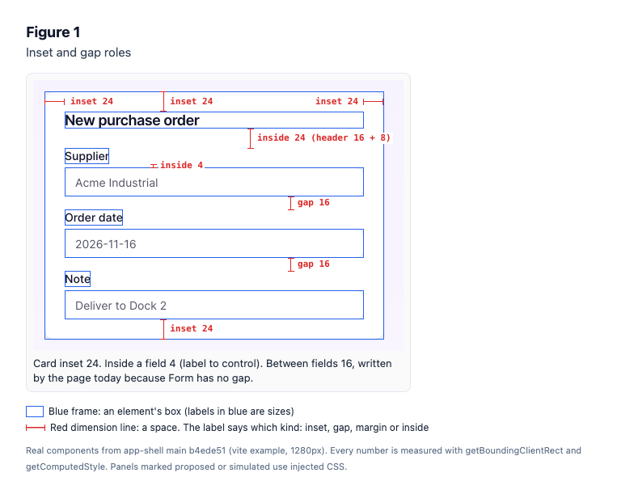
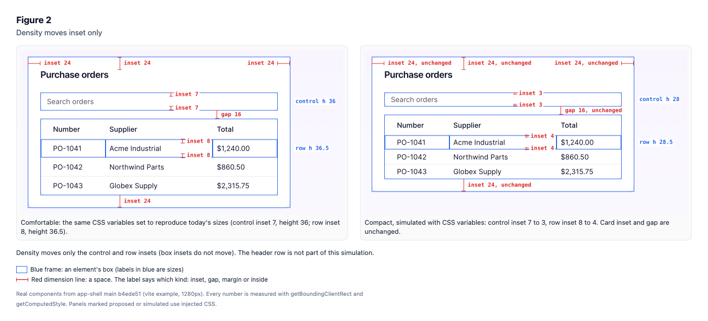
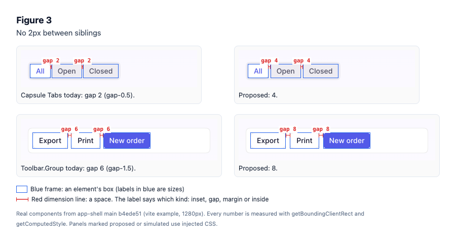
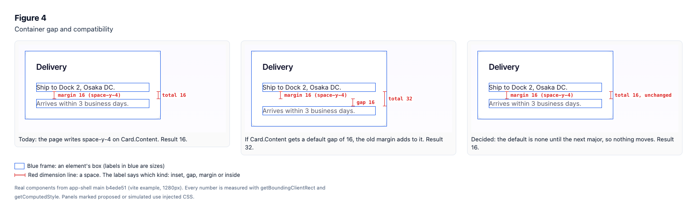
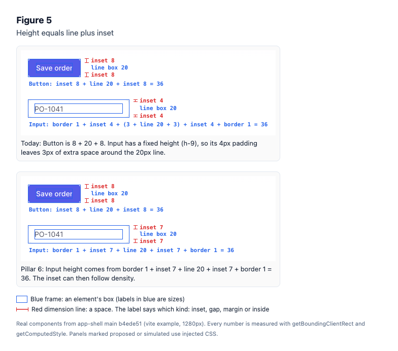
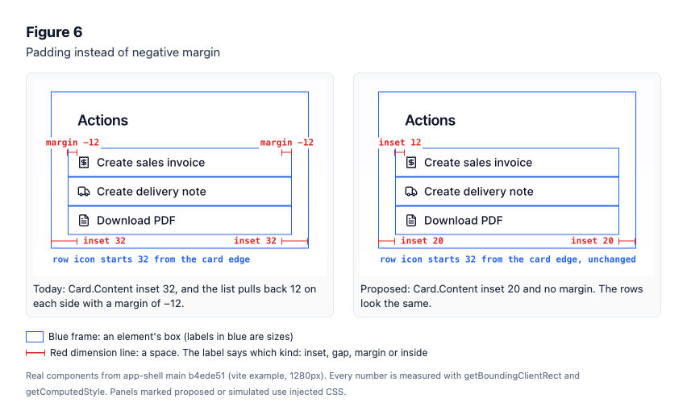

# Decision: spacing roles

> Status: **Proposed. The rule and the seven pillars are for discussion. Density is a separate axis that moves only the block inset of controls and rows (D1), 2px steps are allowed only inside a component (D2), and sibling spacing uses a `gap` prop on existing containers plus one `Inline` primitive (D3). Defaults, names and the variable groups are set in "Decided details". The density values and the order of changes are open.**
> Scope: spacing inside and between AppShell components in `packages/core`: inset, sibling gaps, margins, control heights and density. Page breakpoints and touch target sizes are covered only where they meet these rules.

## Context

Tracking issue: tailor-inc/platform-planning#2484.

AppShell defines no spacing tokens. `docs/concepts/styling-theming.md` tells consumers to use Tailwind's 4px scale, and each component writes its own `p-*`, `gap-*` and `m-*` classes. Measured on `main` at `b4ede51` and on the erp-kit templates at `6f68c339`:

- **Values are mostly on the 4px scale, but not all.** In `packages/core/src/components`, 115 padding and gap classes use a 2px step (`0.5`, `1.5`, `2.5`). 16 of them space siblings, for example capsule tabs (`gap-0.5`), `Toolbar.Group` (`gap-1.5`) and breadcrumb items (`gap-1.5`). The other 99 are inside a component: the inset, the space between an icon and its label, and line alignment.
- **Some components own their outer spacing.** `Tabs.Panel` (`mt-2`), `Table` caption (`mt-4`), `SidebarSeparator`, `ItemList.Separator`, and the AI chat disclosure panels set a margin on their own root. Nine places use a negative margin to cancel the parent's inset (`ActionPanel`, `ActivityCard`, the DataTable sort header, the content scroll area, the menu, select and DataTable context-menu separators, and `SidebarTrigger` in two headers).
- **Containers do not own the gap between their children.** `Layout` and `Layout.Column` space their children by 16px, and consumers use them: erp-kit renders `Layout.Column` 127 times. But `Card.Content`, `Form`, `Fieldset` and `Tabs.Panel` set no gap. In erp-kit, 488 spacing classes in 131 of 418 files are written by hand. Of the 273 vertical stacks, 169 sit directly under one of these containers (an upper bound: only the first level can move to the container). For the 188 horizontal rows, the only horizontal container is `Toolbar.Group`, which is meant for toolbars.
- **Hand-written values cluster by role.** In erp-kit, vertical stacks use 16px (104) and 24px (55) most. Horizontal rows use 8px (113 of 188).
- **Density exists in pieces.** `FilterRail` has a `density` prop (rows 32 or 40px). DataTable overrides control heights with `h-8` on 18 lines. `size` means different heights in different components (`Button` `sm` is 32px, `ItemList` and the sidebar menu `sm` are 28px). There are no spacing CSS variables, and no `pointer: coarse` rule.
- **Control heights are fixed values.** `Input`, `Select`, `Combobox`, `Autocomplete` and the date fields are `h-9`. `Button` `xs`, `sm` and `lg` set only a height. A padding change does not change these heights.

We looked at eight design systems (Atlassian, Spectrum, Material 3, Carbon, Polaris, Primer, Fluent 2, Apple HIG) and the sources they cite. They agree that distance shows relation and that the parent owns the space between children. They differ on density and on whether roles are tokens or components. See References.

### How to read the figures

Each figure renders real AppShell components from the vite example at `b4ede51`, at 1280px. A blue line frames an element (its border box). A red dimension line with a label shows a space: `inset` (between an element's edge and its content), `gap` (between siblings), `margin`, or `inside` (between parts of one component). Every number is measured with `getBoundingClientRect` and `getComputedStyle`. Panels marked "proposed" or "simulated" add CSS to show a state that does not exist yet.

## Decision

### The rule

> Space shows how closely things are related. A box owns only its inset. The parent owns the space between siblings. All steps are on a 4px scale, and each role uses its own range. A control's height is its line box plus its block inset. Density is a separate axis that moves only the block inset, and it does not depend on screen width. Screen width changes only the page's outer spacing.

### Seven pillars

| #   | Pillar                  | Rule                                                                                                                                                                         | Evidence                                                                                                                                                            |
| --- | ----------------------- | ---------------------------------------------------------------------------------------------------------------------------------------------------------------------------- | ------------------------------------------------------------------------------------------------------------------------------------------------------------------- |
| 1   | Scale                   | Steps are multiples of 4px. 2, 6 and 10px are allowed only inside a component (D2).                                                                                          | Convention. Most systems use 4px; several also have 2 and 6.                                                                                                        |
| 2   | Roles                   | Three roles: inset (inside a box), stack (between vertical siblings), inline (between horizontal siblings). Roles are expressed by component props, not by token names (D3). | Convention. Atlassian, Polaris and Carbon express roles with components.                                                                                            |
| 3   | Distance shows relation | Inside a component: 2 to 12px, owned by the component. Siblings that form one group: 8px (`tight`). Related components: 16px (`normal`). Sections: 24px (`loose`) or more.   | Strong. Gestalt proximity (Wertheimer); Spectrum, Carbon and Fluent state the same principle. No system orders the steps by relation; AppShell defines this itself. |
| 4   | Owner                   | A component does not set a margin on its root. A child that must reach the parent's edge gets it from the parent's padding, not from a negative margin.                      | Medium. Carbon `Stack` and React Spectrum state it; Every Layout and Stoiber argue for it.                                                                          |
| 5   | Density                 | Density is separate from `size`. An ancestor marker sets CSS variables, and components read them for their block inset only (D1).                                            | Medium. Carbon (layout context for size and density), Material (4px density interval), Primer (separate sizes for coarse pointers).                                 |
| 6   | Control height          | Height = line box + 2 × block inset (+ border). Heights stay 28 / 32 / 36 / 40px; the inset is derived from the typography role's line height.                               | Strong. Primer publishes the formula; Fluent's button follows it.                                                                                                   |
| 7   | Screen width            | Only the page's outer padding changes with width. Component insets and gaps do not.                                                                                          | Convention. Carbon and Primer do the same. AppShell already does this.                                                                                              |

### D1: Density

- The main mechanism follows Carbon. An ancestor carries a density marker, and the marker sets CSS variables for block inset. Components read the variables. `size` and density are separate axes: `size` picks the height step, density moves the inset inside it.
- Density moves only the block (top and bottom) inset of controls and rows. It does not change text size, inline inset, gaps or box insets.
- Touch is an exception that follows Primer. Under `pointer: coarse`, the same variables get larger values, whatever the screen width.
- The lower limit is WCAG 2.5.8: a target is at least 24 × 24 CSS px, or has enough space around it.

Variables, from the current values:

| Group   | Components                                                                     | Block inset today                           |
| ------- | ------------------------------------------------------------------------------ | ------------------------------------------- |
| Control | `Input`, `Combobox`, `Autocomplete` / `Select` / `Button` default              | 4px (7px with the fixed height) / 8px / 8px |
| Row     | Table cell, menu and select items, `ActionPanel` rows, `DescriptionCard` items | 8px / 6px / 8px / 8px                       |

Box insets (`Card` 24px, `Dialog` 24px, `ActivityCard` 20px, `MetricCard` 16px) do not move with density.

### D2: 2px steps

- 2, 6 and 10px are allowed only inside a component: between an icon and its label, the vertical padding of a badge, adjusting a control's inset so that its height lands on the 4px scale, and line alignment.
- They are not used between siblings. The 16 sibling cases listed in Consequences move to a 4px step.

### D3: Role API

- **Stack: a `gap` prop on the containers that have none today.** `Card.Content`, `Form`, `Fieldset.Root`, `Tabs.Panel`, `Dialog.Content` and `Sheet.Content` accept `gap="none" | "tight" | "normal" | "loose"` (0 / 8 / 16 / 24px). No `Stack` primitive is added.
- **Inline: a new `Inline` primitive** for horizontal rows of siblings (buttons, badges, chips), with the same `gap` names, `align`, and `wrap`.
- `Layout` and `Grid` keep their numeric `gap` props.

### Decided details

1. **Defaults.** The new `gap` props default to `none` until the next major, so that no existing page moves. Docs and templates always pass the value explicitly. Figure 4 shows why: a page that already has `space-y-4` would get 32px with a default of 16.
2. **Density variables.** Two groups: control and row. Box insets do not move with density.
3. **`Inline`.** `Inline` is new. `Toolbar.Group` stays a toolbar part, with its own keyboard navigation, and its gap changes from 6px to 8px.
4. **Names.** `tight`, `normal` and `loose`.
5. **Label and control.** The space between a label and its control is inside a component. `Field` keeps 4px.

## Consequences

- **Pillar 6 comes before density.** Control heights must be rewritten as line box + 2 × block inset before the density variables can change them. Today they are fixed `h-*` values (`Input` family `h-9`, `Button` `xs` / `sm` / `lg`, `ItemList` and sidebar menu items `h-7` / `h-8` / `h-12`, `Tabs` `min-h-*`).

  

- **Margins move to the parent.**

  

  | Where                                              | Today                               | Replacement                                                                                                                                                                      |
  | -------------------------------------------------- | ----------------------------------- | -------------------------------------------------------------------------------------------------------------------------------------------------------------------------------- |
  | `Tabs.Panel`                                       | `mt-2`                              | `Tabs.Root` sets the gap between the list and the panel                                                                                                                          |
  | `Table` caption                                    | `mt-4`                              | the caption's own top padding (gap does not apply inside a table)                                                                                                                |
  | `SidebarSeparator`, `ItemList.Separator`           | `mt-1 mb-2`                         | the separator owns its block padding and draws the line inside, or the parent sets the gap                                                                                       |
  | AI chat disclosure and chain-of-thought panels     | `mt-2`                              | the panel's own top padding, or a gap on the collapsible root                                                                                                                    |
  | Menu, select and DataTable context-menu separators | `-mx-1 my-1`                        | the popup drops its padding and items own their inline inset                                                                                                                     |
  | `ActionPanel` list                                 | `-mx-3`                             | `Card.Content` inset 20 (today's 32 − 12); rows keep their own 12 (Figure 6). This keeps today's look; aligning the card family to 24 is a separate step (see Not in this step). |
  | `ActivityCard` scroll area                         | `-mr-6 pr-6`                        | the content area without end padding; the scroll area owns it                                                                                                                    |
  | DataTable sort header                              | `-mx-2`, `-ml-6 pl-6`, `-mr-6 pr-6` | a sortable header cell without padding; the button owns the inset                                                                                                                |
  | Content scroll area                                | `-mr-4 pr-4`, `md:-mr-8 pr-8`       | `SidebarInset` without end padding; the scroll area owns it                                                                                                                      |
  | `SidebarTrigger` in two headers                    | `-ml-2.5`, `-ml-1`                  | a flush option on icon buttons, or a documented exception                                                                                                                        |

  Not affected: `Tabs.List` uses `-m-[4px]` with `p-[4px]` to make room for the focus ring, so the net effect is zero. The `-mt-8` / `-mt-9` on sidebar labels in icon mode hide the labels; they become `hidden`, not spacing.

- **16 sibling gaps move to a 4px step:** `ai-chat/actions.tsx:14`, `ai-chat/chat-history.tsx:51`, `ai-chat/header.tsx:43`, `ai-chat/response.tsx:90` and `:94`, `ai-chat/suggestion.tsx:13`, `data-table/filters/editors.tsx:715`, `data-table/filters/inputs.tsx:40`, `filter-rail/controls.tsx:72` and `:184`, `internals/breadcrumb/breadcrumb.tsx:17` (two classes), `sidebar/primitives.tsx:609`, `sidebar/sidebar-group.tsx:201`, `tabs/tabs.tsx:12`, `toolbar/toolbar.tsx:171`. Six margins between siblings also move: `command-palette.tsx:586`, `data-table/column-settings.tsx:324`, `data-table/selection-bar.tsx:115` and `:163`, `filter-rail/internals.tsx:100` and `:247`.
- **Controls get sizes instead of overrides.** The 18 `h-8` lines in DataTable and the `h-7` inputs in `FilterRail` use the input family's `size` prop. `FilterRail`'s `density` becomes the shared density axis. `FilterRail` also uses `compact` for its narrow-screen sheet; that name changes so that it does not mean two things.
- **Visual change.** With a default of `none`, the new `gap` props move nothing. Removing margins and 2px steps moves elements by 2 to 4px.
- **Docs.** The "Spacing" section of `styling-theming` says AppShell defines no spacing tokens. The density variables are tokens, so the section is rewritten with the rule and the role ranges. The bundled skill gets the same rules.

## Checks

Proposed, to be chosen when the first change lands:

- **A usage test in `packages/core`**, like `packages/core/tests/z-index-usage.test.ts`: no 2px step in `gap-*`, `space-*` or `m*-*` classes except an allowlist of inside-a-component cases; no margin on an element that carries a public `data-slot`.
- **A browser size test**: for each control and each `size`, the computed height equals line box + 2 × block inset (+ border) at each density, and under `pointer: coarse`.
- **A lint rule in `@tailor-platform/eslint-plugin`** for consumer code: no `h-*` class on AppShell controls, and no margin class on AppShell components.
- **Skill rules**: use the container `gap` prop or `Inline` for siblings; get to an edge with the parent's padding; do not add margins to AppShell components.

## Not in this step

- Breakpoints for multi-column layouts (tailor-inc/platform-planning#2207).
- Card family insets (`ActionPanel`, `ActivityCard`, `DocumentProgressCard` and `MetricCard` differ from 24px). They follow pillar 3 once this record is accepted.
- `Grid`'s default gap of 12px, which is below `normal`.

## Open questions

- **Density values.** The values of the control and row variables at each density level and under `pointer: coarse`.
- **Order of changes.** Which change lands first. Pillar 6 is a prerequisite for density; the 2px and margin fixes do not depend on anything.

## References

Measurements (2026-10-24, 2026-11-01, 2026-11-15) were taken on the vite example and on the source; values above are from `b4ede51` and erp-kit `6f68c339`. Sources checked on 2026-11-16.

- Wertheimer, M. (1923). _Laws of Organization in Perceptual Forms_. Elements that are closer together are seen as a group. English translation: https://psychclassics.yorku.ca/Wertheimer/Forms/forms.htm
- WCAG 2.2, Understanding Success Criterion 2.5.8: Target Size (Minimum): https://www.w3.org/WAI/WCAG22/Understanding/target-size-minimum.html
- Primer primitives v11.7.0 release notes. States the control sizing formula `size = lineBoxHeight + 2 × paddingBlock`: https://github.com/primer/primitives/releases/tag/v11.7.0 . Separate size tokens for coarse pointers: https://github.com/primer/primitives/blob/main/src/tokens/functional/size/size-coarse.json5
- Carbon, Stack component. The Stack lets components avoid margin and leave positioning and layout to their parent: https://github.com/carbon-design-system/carbon/blob/main/packages/web-components/src/components/stack/stack.mdx . Layout context with separate `size` and `density` groups: https://github.com/carbon-design-system/carbon/blob/main/packages/styles/scss/_layout.scss
- Material Components, `@material/density`. Density is applied in steps of 4px from the component's base height: https://github.com/material-components/material-components-web/blob/master/packages/mdc-density/README.md
- React Spectrum, Layout. Spacing between components should be set by parent layout components, not by margins on children: https://github.com/adobe/react-spectrum/blob/main/packages/dev/docs/pages/react-spectrum/layout.mdx
- Fluent UI React v9, Button styles. The medium button has no fixed height: padding 5px + line height 20px + padding 5px + 1px borders = 32px: https://github.com/microsoft/fluentui/blob/master/packages/react-components/react-button/library/src/components/Button/useButtonStyles.styles.ts
- Every Layout, "The Stack". Spacing is set on the context, not on each element: https://every-layout.dev/layouts/stack/
- Max Stoiber, "Margin considered harmful" (2020). Argues that components should not set their own margin: https://mxstbr.com/thoughts/margin
